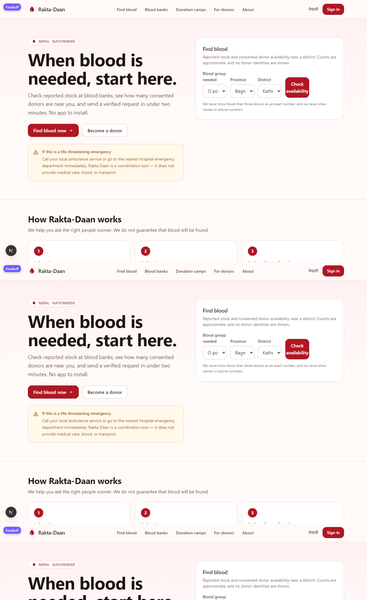

# Rakta-Daan

**Find blood fast. Connect responsibly. Save time.**

A Nepal-first, bilingual (English / नेपाली), mobile-first **website** for finding blood-bank
information, discovering consented donors and starting a blood request — without installing
an app.




> **Not an emergency service.** Rakta-Daan coordinates; it does not provide blood, transport
> or medical care, and it never claims blood will be found. Inventory shows its freshness or
> says *unknown*; queued messages are never shown as delivered; demo surfaces are labelled
> demo.

## Quick start

```bash
pnpm install
cp .env.example .env.local     # edit secrets for your machine
pnpm db:up                     # PostgreSQL 16 on 127.0.0.1:5435 (Docker)
pnpm db:migrate                # apply drizzle migrations
pnpm db:seed:demo              # clearly-labelled demo fixtures (not production data)
pnpm dev                       # http://localhost:3000
# if 3000 is already taken on your machine:  pnpm exec next dev -p 3010
```

Verify everything:

```bash
pnpm verify        # typecheck && lint && test && build
pnpm test:e2e      # Playwright journeys (starts its own dev server on :3100)
pnpm dev           # then in another shell:
SMOKE_BASE_URL=http://localhost:3000 pnpm smoke
```

All commands above were executed successfully — last verified **30 October 2026**:
180 unit/integration tests and 40 Playwright tests (9 specs, 15 axe audits, 0 violations),
plus a clean production build. See [docs/frontend/testing.md](docs/frontend/testing.md)
for the full results and the failures found and fixed along the way.

## What is real and what is simulated

| Real (verified by tests) | Simulated (clearly labelled, browser-local) |
|---|---|
| Public search, results, blood-bank directory, camps, public request pages | `/request/new`, `/request/status/*`, `/donor/demo/*`, `/org/demo`, `/admin/demo` |
| OTP login, requester dashboard, donor console, org inventory, admin console | Dashboard previews built on synthetic fixtures in `src/mocks/fixtures.ts` |
| Matching, consent, encryption at rest, rate limits, audit, retention | Notification previews — **"no real message has been sent"** |
| `MESSAGING_PROVIDER=mock` → states reported as `simulated`, never `delivered` | Live SMS/WhatsApp delivery awaits credentials |
| | The whole `/app` coordination prototype: demo scenarios, contact panels, maps, waves (`src/lib/coordination/`) |

Every demo route renders a `DemoBanner` and is `noindex`; fixtures contain no real personal
data.

## Responsive layout — three tiers

One layout per device class, rather than one phone layout stretched onto a monitor:

| Tier | Viewport | What it looks like |
|---|---|---|
| **Mobile** | < 768px | Single column, 1rem gutters, five-tab bar pinned to the viewport from the first pixel |
| **Tablet** | ≥ 768px | 2rem gutters; peer cards in two columns (track overview, app home, donor dashboard, role previews, consent purposes, scenarios) |
| **Desktop** | ≥ 1280px | Page widens to 80rem (`max-w-6xl` on `/app` → 1152px of content), card rows in three columns, tab-bar targets grow 512px → 896px |

The mobile tier is untouched by the wider ones. `tests/e2e/responsive-tiers.spec.ts` measures
real geometry at 390 / 768 / 1440 — stacked, split, three-column — so the tiers cannot
silently collapse back into one; `tests/e2e/bottom-nav.spec.ts` does the same for the tab bar
across all 16 routes in both locales.


## What is not finished

Stated plainly so nothing is oversold; each item is either labelled in the UI or documented
as an integration boundary (full list: [docs/frontend/frontend-limitations.md](docs/frontend/frontend-limitations.md)):

- **The `/app` coordination prototype is browser-local** — no API, no server-side
  authorisation, no persistence beyond `localStorage`. The domain rules are unit-tested but
  enforced in the client, which is not a security boundary.
- **No message is ever delivered.** `MESSAGING_PROVIDER=mock` reports `simulated`, never
  `delivered`; SMS/WhatsApp/Viber, the call preview and push notifications await credentials.
- **No live location stream.** Consent, purposes and the trip map exist; there is no position
  feed behind them.
- **No map tiles or routing** — district-level schematic geometry only.
- **Accessibility review with real assistive tech** (screen-reader passes in both languages,
  high-contrast mode) is outstanding — see
  [docs/frontend/accessibility.md](docs/frontend/accessibility.md) §3.

## Mobile coordination prototype (`/en/app`)

The mobile-first emergency coordination journey, runnable entirely in the browser:

```bash
pnpm dev                    # http://localhost:3000
# open /en/app on a phone-sized viewport (390px)
```

1. **Home** (`/en/app`) — a persistent bottom tab bar fixed to the bottom of the viewport
   for the whole document: **Home · Find · Request · Track · Profile**. The same five tabs
   appear for every role and at every screen width; secondary pages live on Profile.
2. **Demo scenarios** (`/en/app/scenarios`) — load one of three seeded scenarios, or
   reset all demo data with confirmation.
3. **Track** (`/en/app/track`) — coverage progress, the **trip map** (donor ↔ receiver ends,
   distance and ETA, consent-gated and labelled simulated), participants lifecycle,
   notification waves, map/list with a district-level-only disclaimer, activity timeline,
   request actions (increase / expire / cancel / close), and the **Contact** tab.
4. **Donor** (`/en/app/donor`) — availability, invitations (accept / decline / withdraw),
   eligibility shown as a display status only, donation history with verification labels.
5. **Contact** (`/app/track` → Contact tab, and inline on donor invitations) — external
   channels only. Contact details stay hidden until the person sharing them consents;
   calling is a labelled preview, and WhatsApp/Viber/SMS are stated as not connected.
   **There is no in-app inbox** — see
   [docs/frontend/external-contact-links.md](docs/frontend/external-contact-links.md).
6. **Profile** (`/en/app/profile`) — current view with an avatar upload, then collapsible
   groups: donor details (group, district, eligibility, last donation), donation history and
   certificates, contact preferences, privacy/consent state, and settings (role switch,
   reset). Every secondary section of the site hangs off the bottom of it.
7. **Location** (`/en/app/location`) — four independent, individually reversible location
   purposes (discovery, matching, donor live, requester live), each off by default.
8. **Role previews** (`/en/app/roles`) — facility, coordinator and admin mobile views.

The rules live in `src/lib/coordination/` as a pure, unit-tested domain layer (request
machine, waves, eligibility, scenarios, store). Frontend only: nothing here talks to a
backend, and no message, call or live location ever leaves the browser.

## Project structure

```
src/
├── app/                 # Next.js App Router: [locale] pages, api routes, metadata
│   ├── [locale]/        #   en + ne routes (find, banks, camps, request, donor, org, admin, learn, legal…)
│   └── api/             #   existing JSON API + webhooks + cron endpoint
├── components/
│   ├── ui/              # primitives: Badge, Callout, PageHeader, EmptyState, icons…
│   ├── layout/          # header, footer, mobile menu, language switcher
│   ├── mobile/          # sticky role-aware bottom navigation (app footer, every width)
│   ├── coordination/    # mobile emergency flow: track, contact, map, waves, scenarios…
│   ├── blood-search/    # FindForm, BloodGroupPicker
│   ├── auth/            # OTP login
│   ├── request/         # request form, owner actions, donor response buttons
│   ├── donor/           # registration, availability/consent controls
│   ├── organization/    # inventory form
│   ├── admin/           # verification, camps, abuse actions
│   ├── feedback/        # abuse report form
│   └── demo/            # labelled demonstration surfaces
├── services/api.ts      # single typed entry point for API calls (future swap point)
├── mocks/               # browser-local demo stores + synthetic fixtures
├── hooks/               # shared client hooks
├── lib/                 # domain logic (matching, consent, crypto, messaging, i18n…)
│   └── coordination/    #   pure coordination domain: request machine, waves, eligibility
├── data/geography.ts    # province/district reference data (not mock data)
├── messages/            # en + ne dictionaries (typed parity)
├── content/             # static content pages
└── db/                  # schema + connection (backend phase — untouched by frontend work)
```

Design tokens and component classes live in [src/app/globals.css](src/app/globals.css).

## Commands

| Command | Purpose |
|---|---|
| `pnpm dev` / `pnpm build` / `pnpm start` | Run the site (ports 3000; Playwright uses 3100) |
| `pnpm typecheck` / `pnpm lint` | `tsc --noEmit` / `eslint .` |
| `pnpm test` | Vitest unit + integration (auto-creates `rakta_daan_test`) |
| `pnpm test:e2e` | Playwright browser journeys + axe accessibility audits (`E2E_BASE_URL=…` reuses a running server) |
| `pnpm db:up` `db:down` `db:migrate` `db:generate` `db:reset` `db:seed` `db:seed:demo` | Database lifecycle |
| `pnpm smoke` | HTTP end-to-end checks against a running server |
| `pnpm outbox` | Manual cron run: dispatch, expiry, retention |
| `pnpm verify` | typecheck + lint + test + build |

## Environment variables

Documented with comments in [.env.example](.env.example) — that file is the source of truth:

`DATABASE_URL`, `AUTH_SECRET`, `OTP_PEPPER`, `CRON_SECRET`, `WEBHOOK_SECRET`, `APP_URL`,
`DEV_EXPOSE_OTP` (development only), `MESSAGING_PROVIDER`, `MESSAGING_FROM_NAME`,
`SPARROW_*`, `WHATSAPP_*`, `TEST_DATABASE_URL`.

No secret reaches the browser: there are no `NEXT_PUBLIC_*` provider keys, and no client
flag can enable real messaging.

## Documentation

### Frontend (design & prototype phase)

| Document | Contents |
|---|---|
| [docs/frontend/repository-audit.md](docs/frontend/repository-audit.md) | Stack found, what was reused, what changed |
| [docs/frontend/competitive-analysis.md](docs/frontend/competitive-analysis.md) | 9 platforms, classified by evidence |
| [docs/frontend/ux-opportunities.md](docs/frontend/ux-opportunities.md) | Research → opportunity → status |
| [docs/frontend/information-architecture.md](docs/frontend/information-architecture.md) | Sitemap, layers, navigation |
| [docs/frontend/ux-decisions.md](docs/frontend/ux-decisions.md) | The design decisions and what they rule out |
| [docs/frontend/location-tracking.md](docs/frontend/location-tracking.md) | Browser permissions, consent, privacy, limits |
| [docs/frontend/external-contact-links.md](docs/frontend/external-contact-links.md) | Supported contact actions and fallbacks |
| [docs/frontend/demo-scenarios.md](docs/frontend/demo-scenarios.md) | How to demonstrate the primary flows |
| [docs/frontend/frontend-limitations.md](docs/frontend/frontend-limitations.md) | Mock data and what is not production-ready |
| [docs/frontend/user-journeys.md](docs/frontend/user-journeys.md) | Journeys A–F with test mapping |
| [docs/frontend/design-system.md](docs/frontend/design-system.md) | Tokens, typography, icons, conventions |
| [docs/frontend/component-catalog.md](docs/frontend/component-catalog.md) | Every component, grouped |
| [docs/frontend/mock-data.md](docs/frontend/mock-data.md) | Demo stores, fixtures, labelling rules |
| [docs/frontend/raktkhoj-comparison.md](docs/frontend/raktkhoj-comparison.md) | RaktKhoj flow study: notifications, acceptance, tracking + card-style UI language |
| [docs/frontend/backend-integration-contract.md](docs/frontend/backend-integration-contract.md) | Service boundary and swap plan |
| [docs/frontend/localization.md](docs/frontend/localization.md) | en/ne system and rules |
| [docs/frontend/accessibility.md](docs/frontend/accessibility.md) | WCAG target, evidence, gaps |
| [docs/frontend/testing.md](docs/frontend/testing.md) | Test layers and actual results |
| [docs/frontend/seo-performance.md](docs/frontend/seo-performance.md) | SEO configuration + measured TTFB/payload |
| [docs/frontend/acceptance-criteria.md](docs/frontend/acceptance-criteria.md) | Brief §26 checklist mapped to evidence |
| [docs/frontend/environment-setup.md](docs/frontend/environment-setup.md) | Verified setup/run commands |
| [docs/frontend/completion-report.md](docs/frontend/completion-report.md) | Delivery report |

### Platform (earlier full-stack phase)

[docs/product/product-requirements.md](docs/product/product-requirements.md) ·
[docs/product/assumptions-and-decisions.md](docs/product/assumptions-and-decisions.md) ·
[docs/product/acceptance-criteria.md](docs/product/acceptance-criteria.md) ·
[docs/architecture.md](docs/architecture.md) (schema + ERD) ·
[docs/security-privacy.md](docs/security-privacy.md) ·
[docs/messaging-integration.md](docs/messaging-integration.md) ·
[docs/deployment.md](docs/deployment.md) ·
[docs/research/](docs/research/) ·
[docs/final-report.md](docs/final-report.md)

## Contributing to the frontend

```text
New page        → src/app/[locale]/<segment>/page.tsx + strings in src/messages/{en,ne}.ts
New UI primitive→ src/components/ui/  (+ document in component-catalog.md)
New feature UI  → src/components/<feature>/
API call        → typed helper in src/services/api.ts  (never fetch inside components)
Demo surface    → src/mocks/ + <DemoBanner> + robots noindex
```

Rules of the road: one design system (no second icon/colour language), labels on every
status, no dead buttons, no fabricated data, and both dictionaries updated together.
