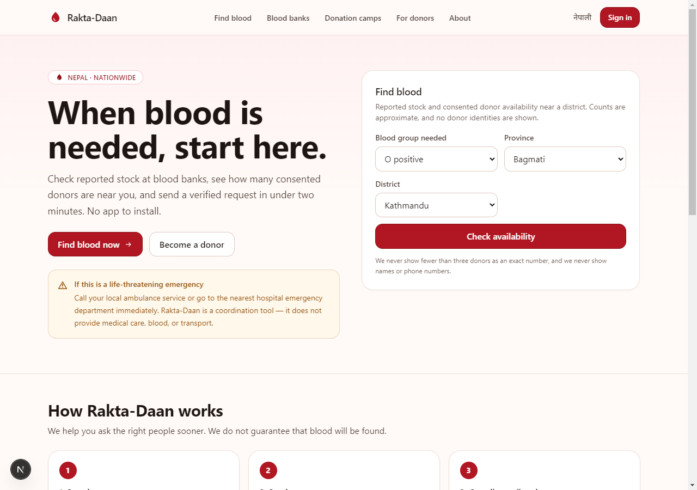
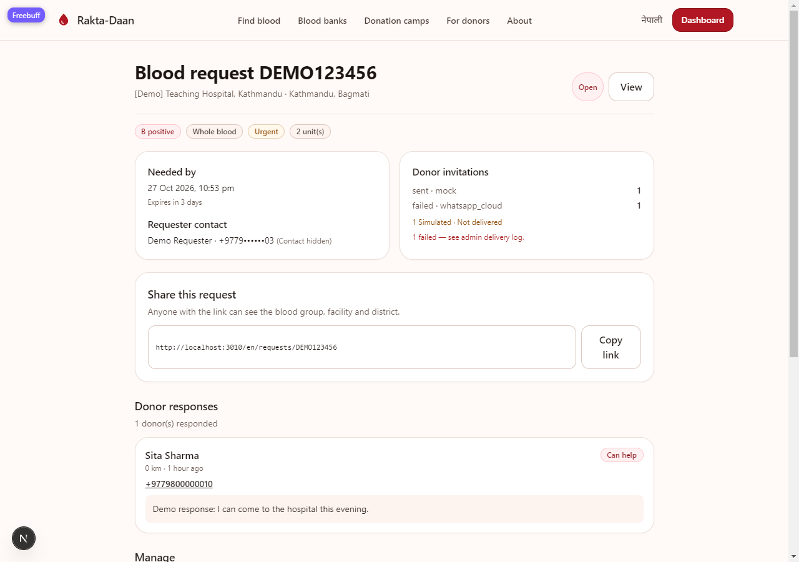
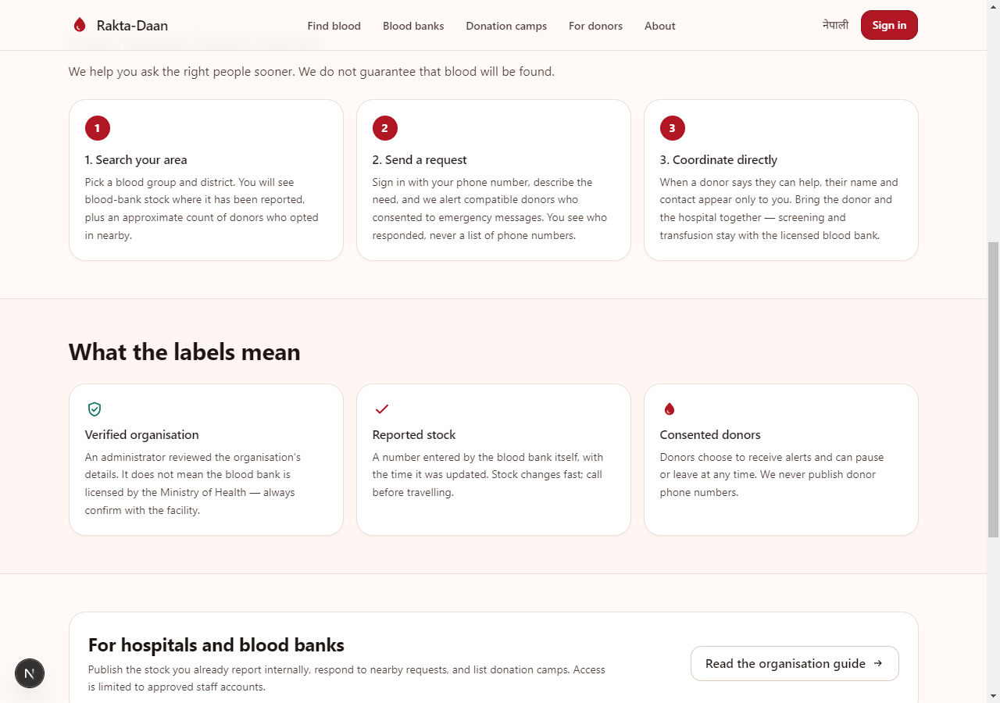
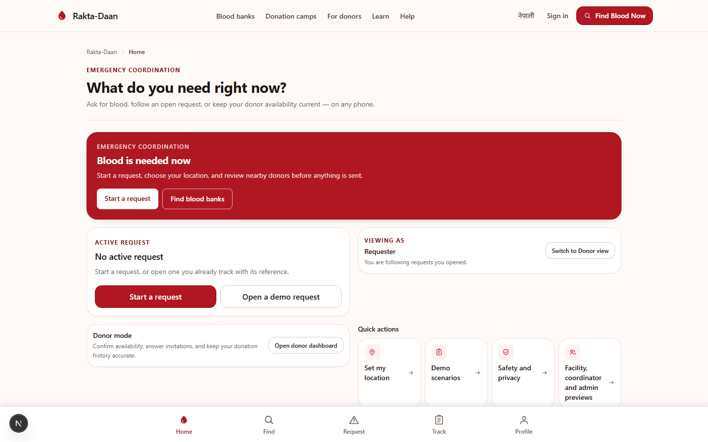

# Rakta-Daan

  <b>Find blood fast. Connect responsibly. Save time.</b> 
  A Nepal-first, bilingual (English / नेपाली), mobile-first website for finding blood-bank
  information, discovering consented donors, and starting a blood request — without installing an app.

  
  
  
  
    
  
  
  
  
  
  

---

   
  <em>Homepage — desktop view</em>

  
  
  
   
  <em>Left to right: home hero, Nepali localisation, search results</em>

---

## 🩸 What Rakta-Daan does

**Rakta-Daan** coordinates blood donation in Nepal through a lightweight, mobile-first web app — no installation required.

| Capability | What it does |
|------------|--------------|
| 🏥 **Blood-bank directory** | Browse and search registered blood banks by district |
| 🏕️ **Donation camps** | Find upcoming blood donation camps near you |
| 🤝 **Consented donors** | Discover donors who have opted in to be contacted |
| 📋 **Blood requests** | Create and track a blood request (public or private) |
| 📱 **Mobile-first** | Works on phones, tablets, and desktops with tiered layouts |
| 🇳🇵 **Bilingual** | Full English / नेपाली localisation with both dictionaries kept in sync |

---

## ⚠️ Important disclaimer

> **Not an emergency service.** Rakta-Daan coordinates; it does not provide blood, transport, or medical care, and it never claims blood will be found. Inventory shows its freshness or says *unknown*; queued messages are never shown as delivered; demo surfaces are labelled **demo**.

---

## 🚀 Quick start

`ash
# 1. Install dependencies
pnpm install

# 2. Configure environment
cp .env.example .env.local      # edit secrets for your machine

# 3. Start database (PostgreSQL 16 on 127.0.0.1:5435 via Docker)
pnpm db:up

# 4. Apply database migrations
pnpm db:migrate

# 5. Seed demo fixtures (clearly-labelled demo data — not production)
pnpm db:seed:demo

# 6. Start the dev server
pnpm dev                         # http://localhost:3000
# If port 3000 is taken: pnpm exec next dev -p 3010
`

### Verify everything works

`ash
# Typecheck, lint, tests, and build
pnpm verify

# Playwright end-to-end journeys (starts its own dev server on :3100)
pnpm test:e2e

# Smoke test against a running dev server
SMOKE_BASE_URL=http://localhost:3000 pnpm smoke
`

CI runs the same gates on every push and pull request — see [.github/workflows/ci.yml](.github/workflows/ci.yml).

📖 Table of contents — click to expand

### Frontend (Next.js App Router)
| Document | What it covers |
|----------|----------------|
| [docs/frontend/design-system.md](docs/frontend/design-system.md) | Tokens, typography, icons, conventions |
| [docs/frontend/component-catalog.md](docs/frontend/component-catalog.md) | Every component, grouped |
| [docs/frontend/ux-decisions.md](docs/frontend/ux-decisions.md) | Design decisions and what they rule out |
| [docs/frontend/information-architecture.md](docs/frontend/information-architecture.md) | Sitemap, layers, navigation |
| [docs/frontend/localization.md](docs/frontend/localization.md) | English / नेपाली system and rules |
| [docs/frontend/location-tracking.md](docs/frontend/location-tracking.md) | Browser permissions, consent, privacy, limits |
| [docs/frontend/external-contact-links.md](docs/frontend/external-contact-links.md) | Supported contact actions and fallbacks |
| [docs/frontend/demo-scenarios.md](docs/frontend/demo-scenarios.md) | How to demonstrate the primary flows |
| [docs/frontend/frontend-limitations.md](docs/frontend/frontend-limitations.md) | Mock data and what is not production-ready |
| [docs/frontend/user-journeys.md](docs/frontend/user-journeys.md) | Journeys A–F with test mapping |
| [docs/frontend/mock-data.md](docs/frontend/mock-data.md) | Demo stores, fixtures, labelling rules |
| [docs/frontend/raktkhoj-comparison.md](docs/frontend/raktkhoj-comparison.md) | RaktKhoj flow study and card-style UI language |
| [docs/frontend/backend-integration-contract.md](docs/frontend/backend-integration-contract.md) | Service boundary and swap plan |
| [docs/frontend/accessibility.md](docs/frontend/accessibility.md) | WCAG target, evidence, gaps |
| [docs/frontend/testing.md](docs/frontend/testing.md) | Test layers and actual results |
| [docs/frontend/seo-performance.md](docs/frontend/seo-performance.md) | SEO configuration + measured TTFB/payload |
| [docs/frontend/acceptance-criteria.md](docs/frontend/acceptance-criteria.md) | §26 checklist mapped to evidence |
| [docs/frontend/environment-setup.md](docs/frontend/environment-setup.md) | Verified setup/run commands |
| [docs/frontend/completion-report.md](docs/frontend/completion-report.md) | Delivery report |

### Platform (earlier full-stack phase)
| Document | What it covers |
|----------|----------------|
| [docs/product/product-requirements.md](docs/product/product-requirements.md) | Product requirements |
| [docs/product/assumptions-and-decisions.md](docs/product/assumptions-and-decisions.md) | Assumptions and decisions |
| [docs/product/acceptance-criteria.md](docs/product/acceptance-criteria.md) | Acceptance criteria |
| [docs/architecture.md](docs/architecture.md) | Schema + ERD |
| [docs/security-privacy.md](docs/security-privacy.md) | Security and privacy |
| [docs/messaging-integration.md](docs/messaging-integration.md) | Messaging integration |
| [docs/deployment.md](docs/deployment.md) | Deployment instructions |
| [docs/research/](docs/research/) | Competitor and user research |
| [docs/final-report.md](docs/final-report.md) | Final project report |

---

## ☕ Backend API (NestJS)

The NestJS backend provides authentication, user management, blood request creation,
donor matching, and data persistence.

### Quick start

`ash
# 1. Start PostgreSQL and Redis
docker-compose up -d postgres redis

# 2. Setup database
cd apps/api
npx prisma migrate deploy
npx prisma generate

# 3. Start the API server
pnpm start:prod
# API available at http://localhost:4000
# Swagger docs at http://localhost:4000/api/docs
`

### Environment variables

Copy .env.example and update with your configuration:

`ash
cp .env.example .env
# Edit .env with your database, JWT secrets, SMS credentials, etc.
`

### API endpoints

| Method | Endpoint | Description |
|--------|----------|-------------|
| POST | /auth/otp/request | Request OTP for phone |
| POST | /auth/otp/verify | Verify OTP and get session |
| POST | /auth/logout | Logout session |
| GET | /donors | Get donor profiles |
| POST | /donors | Create donor profile |
| GET | /donors/me | Get current user donor profile |
| PATCH | /donors/me | Update donor profile |
| GET | /donors/search | Find matching donors |
| GET | /requests | Get blood requests |
| POST | /requests | Create blood request |
| GET | /requests/stats | Get request statistics |
| POST | /admin/stats | Get admin statistics |

Complete API documentation is available at [http://localhost:4000/api/docs](http://localhost:4000/api/docs) when the server is running.

### Service status

| Component | Status |
|-----------|--------|
| TypeScript compilation | ✅ 0 errors |
| PostgreSQL database | ✅ Running on port 5432 |
| NestJS API server | ✅ Running on port 4000 |
| Swagger documentation | ✅ Available at /api/docs |
| Docker setup | ✅ docker-compose.yml ready |
| Deployment guide | ✅ [DEPLOYMENT.md](DEPLOYMENT.md) |

See [DEPLOYMENT.md](DEPLOYMENT.md) for detailed deployment instructions.

---

## 🔍 What is real and what is simulated

| Real (verified by tests) | Simulated (clearly labelled, browser-local) |
|--------------------------|---------------------------------------------|
| Public search, results, blood-bank directory, camps, public request pages | /request/new, /request/status/*, /donor/demo/*, /org/demo, /admin/demo |
| OTP login, requester dashboard, donor console, org inventory, admin console | Dashboard previews built on synthetic fixtures in src/mocks/fixtures.ts |
| Matching, consent, encryption at rest, rate limits, audit, retention | Notification previews — **"no real message has been sent"** |
| MESSAGING_PROVIDER=mock → states reported as simulated, never delivered | Live SMS/WhatsApp delivery awaits credentials |
| | The whole /app coordination prototype: demo scenarios, contact panels, maps, waves (src/lib/coordination/) |

Every demo route renders a DemoBanner and is 
oindex; fixtures contain no real personal data.

---

## 📱 Responsive layout — three tiers

One layout per device class, rather than one phone layout stretched onto a monitor:

| Tier | Viewport | What it looks like |
|------|----------|--------------------|
| **Mobile** | < 768px | Single column, 1rem gutters, five-tab bar pinned to the viewport from the first pixel |
| **Tablet** | ≥ 768px | 2rem gutters; peer cards in two columns (track overview, app home, donor dashboard, role previews, consent purposes, scenarios) |
| **Desktop** | ≥ 1280px | Page widens to 80rem (max-w-6xl on /app → 1152px of content), card rows in three columns, tab-bar targets grow 512px → 896px |

The mobile tier is untouched by the wider ones. 	ests/e2e/responsive-tiers.spec.ts measures
real geometry at 390 / 768 / 1440 — stacked, split, three-column — so the tiers cannot
silently collapse back into one; 	ests/e2e/bottom-nav.spec.ts does the same for the tab bar
across all 16 routes in both locales.

---

## 🛣️ What is not finished

Stated plainly so nothing is oversold; each item is either labelled in the UI or documented
as an integration boundary (full list: [docs/frontend/frontend-limitations.md](docs/frontend/frontend-limitations.md)):

- **The /app coordination prototype is browser-local** — no API, no server-side
  authorisation, no persistence beyond localStorage. The domain rules are unit-tested but
  enforced in the client, which is not a security boundary.
- **No message is ever delivered.** MESSAGING_PROVIDER=mock reports simulated, never
  delivered; SMS/WhatsApp/Viber, the call preview and push notifications await credentials.
- **No live location stream.** Consent, purposes and the trip map exist; there is no position
  feed behind them.
- **No map tiles or routing** — district-level schematic geometry only.
- **Accessibility review with real assistive tech** (screen-reader passes in both languages,
  high-contrast mode) is outstanding — see
  [docs/frontend/accessibility.md](docs/frontend/accessibility.md) §3.

---

## 🎨 Design system

Recent improvements to the user interface and typography:

- **SF Pro font family** — Native iOS/Apple system font with Nepali fallbacks for better readability
- **Enhanced color palette** — Blood-red brand colors with a 50–900 scale for consistent branding
- **Better typography** — Improved scale, line heights, and letter spacing
- **Responsive image optimisation** — Next.js Image component with placeholder blur
- **Card-style UI language** — Consistent elevation, borders, and hover states across all surfaces

See [docs/frontend/design-system.md](docs/frontend/design-system.md) for tokens, typography, icons, and conventions.

---

## 💻 Frontend development (Next.js)

### Adding a new page

`	ext
src/app/[locale]/<segment>/page.tsx    # page component
src/messages/{en,ne}.ts                # strings in both dictionaries
`

### Adding a UI primitive

`	ext
src/components/ui/                     # shadcn-style primitives
# then document it in component-catalog.md
`

### Adding a feature UI

`	ext
src/components/<feature>/              # feature-scoped components
`

### Making an API call

`	ext
src/services/api.ts                    # typed helper — never fetch inside components
`

### Demo surfaces

`	ext
src/mocks/                             # demo stores and fixtures
<DemoBanner> + robots noindex          # every demo route
`

### Rules of the road

- One design system — no second icon or colour language
- Labels on every status
- No dead buttons
- No fabricated data
- Both dictionaries (en and 
e) updated together

A pre-push hook runs pnpm typecheck and pnpm lint — the first two gates CI runs — so a
broken push fails locally first:

`ash
pnpm hooks:install    # git config core.hooksPath .githooks
`

git push --no-verify bypasses it when the hook itself is the problem.

---

## 🏗️ Project structure

`
Rakta-Daan/
├── apps/
│   ├── web/                 # Next.js 15 frontend (App Router)
│   └── api/                 # NestJS 10 backend
├── packages/
│   ├── shared-types/        # Shared TypeScript types
│   ├── validation/          # Shared validation schemas
│   └── config/              # Shared configuration
├── src/
│   ├── app/[locale]/        # Localised pages (en / ne)
│   ├── components/          # UI components
│   ├── lib/                 # Core libraries (coordination, matching, etc.)
│   ├── services/            # API service helpers
│   ├── mocks/               # Demo fixtures and stores
│   └── messages/            # en.ts and ne.ts dictionaries
├── tests/
│   ├── e2e/                 # Playwright end-to-end specs
│   ├── integration/         # Integration tests
│   └── unit/                # Unit tests
├── docs/                    # All project documentation
├── screenshots/             # UI screenshots
└── .githooks/               # Git hooks (pre-push typecheck + lint)
`

---

## 🧪 Testing

| Command | What it runs |
|---------|--------------|
| pnpm verify | typecheck → lint → test → build |
| pnpm test:e2e | Playwright journeys (starts its own dev server on :3100) |
| SMOKE_BASE_URL=http://localhost:3000 pnpm smoke | Smoke test against a running dev server |

Last verified **30 October 2026**: 180 unit/integration tests and 40 Playwright tests
(9 specs, 15 axe audits, 0 violations), plus a clean production build.
See [docs/frontend/testing.md](docs/frontend/testing.md) for full results.

---

## 🤝 Contributing

1. Fork the repository
2. Create your feature branch (git checkout -b feature/amazing-feature)
3. Commit your changes (git commit -m 'Add amazing feature')
4. Push to the branch (git push origin feature/amazing-feature)
5. Open a Pull Request

All contributions should respect the rules of the road: one design system, labels on every
status, no dead buttons, no fabricated data, and both dictionaries updated together.

---

## 📄 License

This project is licensed under the MIT License — see the [LICENSE](LICENSE) file for details.

---

## 🙏 Acknowledgments

- Inspired by [RaktKhoj](docs/frontend/raktkhoj-comparison.md) — flow study for notifications, acceptance, and tracking
- Built with [Next.js](https://nextjs.org), [NestJS](https://nestjs.com), [Tailwind CSS](https://tailwindcss.com), [Prisma](https://prisma.io), and [Playwright](https://playwright.dev)